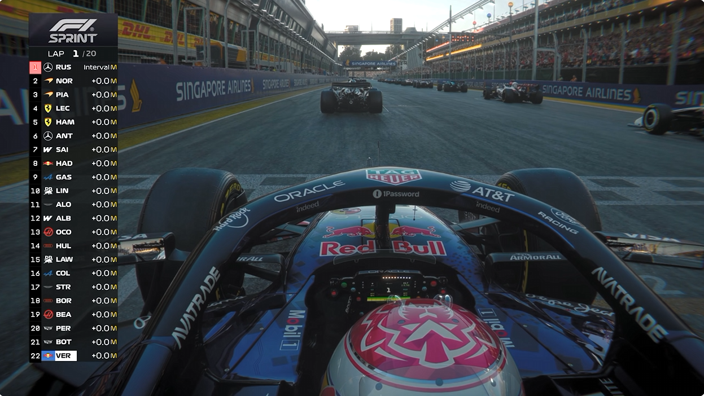
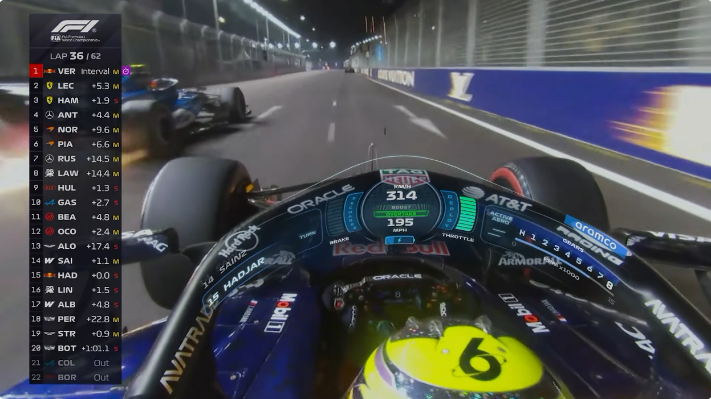
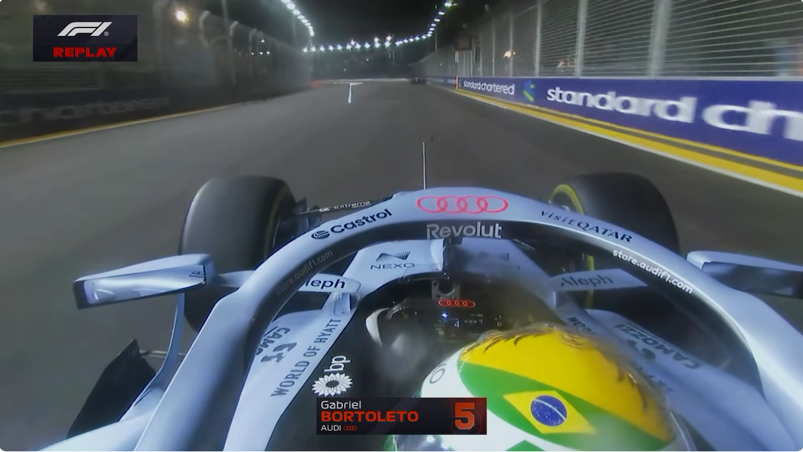
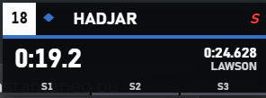
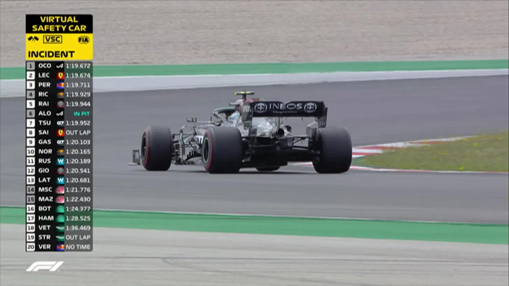
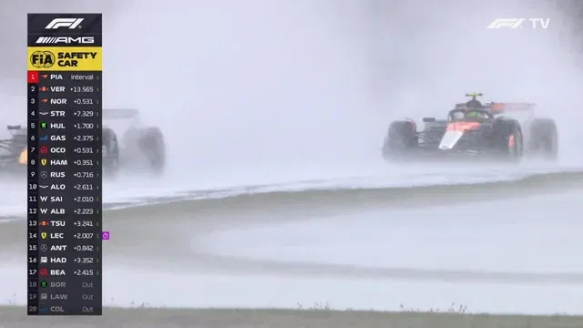
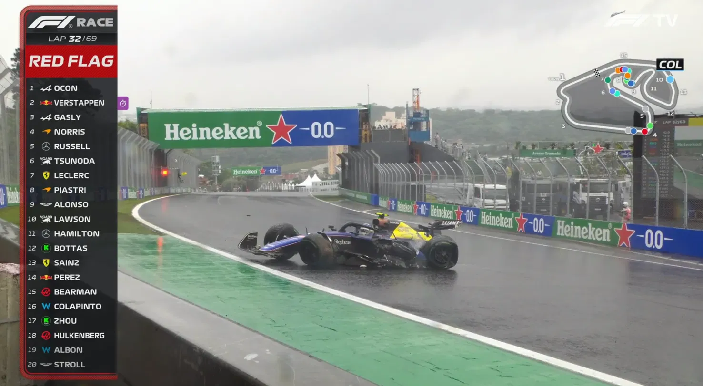
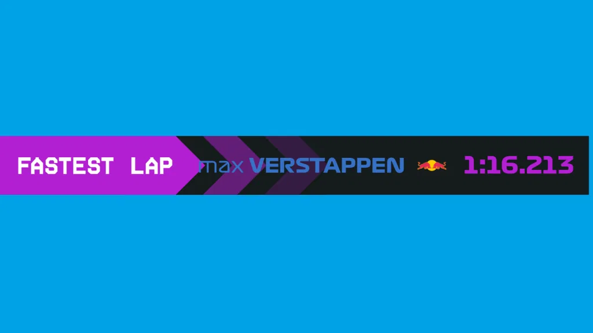

# F1 25 TV Overlay

**Overlay gratuito e de código aberto para F1 25**, inspirado nos gráficos de uma transmissão de Fórmula 1. Qualquer pessoa pode baixar, usar, modificar e compartilhar o programa, inclusive sem pagar. O **código** está sob a [licença MIT](LICENSE).

O programa lê a telemetria UDP do jogo e desenha a HUD em uma janela transparente sobre ele ou em uma fonte de navegador no OBS. Não modifica arquivos nem a memória do F1 25. É um projeto independente de fã; não é um produto oficial da Formula 1, FIA ou EA.

> **Sobre as imagens abaixo:** são prints de referência enviados durante o desenvolvimento, **não capturas do overlay em funcionamento**. Eles ajudam a explicar o visual desejado. São imagens de terceiros e não fazem parte da licença MIT do código.

## Referências visuais

| Torre de tempos | HUD no halo |
|:---:|:---:|
|  |  |

| Identificação onboard | Cartão de volta |
|:---:|:---:|
|  |  |

| Virtual Safety Car | Safety Car |
|:---:|:---:|
|  |  |

| Bandeira vermelha | Volta mais rápida |
|:---:|:---:|
|  |  |

## O que já existe

- **Torre de tempos:** posições, intervalos, pneus, pit, volta e identificação das equipes. O cabeçalho mostra `SPRINT` somente na Sprint Race e `RACE` na corrida normal.
- **Qualificação e treinos:** torre por melhor tempo, zona de eliminação aproximada, cronômetro de volta lançada e cartões com setores e comparação de tempos.
- **Corrida:** cartão de volta do jogador com S1/S2 em tempo real e S3 calculado ao concluir a volta. Amarelo indica setor mais lento, verde melhora pessoal e roxo melhor setor da sessão, quando há dados para comparar.
- **Onboard:** cartão com nome, equipe e número do piloto observado; instrumentos sobre o halo com velocidade, marcha, RPM, freio, acelerador, ERS, Boost, Overtake e asa ativa conforme os pacotes recebidos.
- **Direção de prova:** bandeira amarela, VSC, Safety Car e bandeira vermelha integrados à torre; painel de delta de VSC/SC apenas quando o jogo fornece valor recente; anúncio temporário de volta mais rápida.
- **Ajustes:** cada HUD pode ser ligada/desligada, movida e redimensionada. O halo tem posição e escala por equipe para encaixar em câmeras de carros diferentes.
- **Demonstração:** dados simulados para visualizar os componentes mesmo sem abrir o jogo.

## Requisitos

- Windows e **F1 25** com telemetria UDP ativada. Para os dados e recursos de 2026, selecione o formato **2026 Season Pack** no jogo.
- Node.js com `node` e `npm` disponíveis no terminal. O servidor usa Node 18 ou superior; a instalação do Electron pode exigir uma versão mais recente de Node.js/npm.
- Conexão com a internet **na primeira execução** para instalar o Electron na pasta `janela`.
- O jogo em **Janela (Tela Cheia)** para a janela transparente aparecer sobre ele. No OBS, use a alternativa Browser Source descrita abaixo.

## Instalação rápida

1. Baixe o repositório pelo botão **Code → Download ZIP** do GitHub e extraia, ou clone:

   ```powershell
   git clone https://github.com/thenotrealuser/f1-25-tv-overlay.git
   cd f1-25-tv-overlay
   ```

2. No F1 25, abra **Configurações → Configurações de telemetria** e configure:

   | Opção | Valor |
   |---|---|
   | Telemetria UDP | Ligada |
   | IP de destino | `127.0.0.1` |
   | Porta | `20777` |
   | Frequência | `20 Hz` |
   | Formato | `2026`, para o 2026 Season Pack |
   | Modo de transmissão | `Não` |

3. Dê dois cliques em **`iniciar-overlay.bat`**. Na primeira vez, o script instala o Electron. Deixe a janela do servidor aberta.
4. Entre numa sessão do jogo. O painel de controle abre em `http://127.0.0.1:8080/control` e o overlay aparece sobre o jogo.

Para encerrar, feche a janela do Electron e a janela do servidor. Os ajustes de posição e tamanho permanecem salvos localmente.

### Navegador ou OBS

Para usar apenas o servidor, execute `iniciar.bat` e abra `http://127.0.0.1:8080/`. No OBS, adicione uma **Browser Source** com essa URL, fundo transparente e resolução da fonte igual à da sua cena (por exemplo, 1920×1080). O painel de controle continua em `/control`.

### Ver sem o jogo

Execute `iniciar-demo.bat` para simular uma corrida. Para uma qualificação simulada, execute `node server.js --demo --quali`. A demo mostra estados e animações, mas não comprova o comportamento do jogo real.

## Painel, tamanhos e atalhos

O endereço `http://127.0.0.1:8080/control` permite ligar ou desligar torre, cartões da qualificação, cartão da corrida, identificação onboard, halo, avisos/delta e faixa de volta mais rápida. O modo **Automático** acompanha o tipo de sessão; os modos **Qualificação** e **Corrida** permitem escolher manualmente a apresentação.

Em **Tamanho de cada HUD**, ajuste cada peça entre `0,3×` e `3×`. O halo também tem ajustes horizontal, vertical e de escala por equipe. No **modo de edição**, pause o jogo pelo menu, arraste as HUDs, use o canto amarelo ou a roda do mouse para redimensionar e dê duplo clique para restaurar a posição. Saia com `Esc` ou o mesmo atalho de edição. O cartão da volta pode aparecer no modo de edição para posicionamento; durante o jogo ele só é exibido em corrida.

| Atalho global, com a janela Electron aberta | Ação |
|---|---|
| `Ctrl+Alt+H`, `Ctrl+Shift+H` ou `Ctrl+Alt+F10` | HUD inteira |
| `Ctrl+Alt+T` | Torre |
| `Ctrl+Alt+F` | Avisos na torre e delta VSC/SC |
| `Ctrl+Alt+V` | Faixa de volta mais rápida |
| `Ctrl+Alt+L` | Cartão da volta do jogador |
| `Ctrl+Alt+O` | Identificação onboard |
| `Ctrl+Alt+G` | Instrumentos do halo |
| `Ctrl+Alt+K` | Cartões da qualificação |
| `Ctrl+Alt+M` | Alternar modo de apresentação |
| `Ctrl+Alt+E` ou `Ctrl+Shift+E` | Entrar ou sair do modo de edição |

Com a página do overlay em foco no navegador, as teclas `H`, `T`, `F`, `V`, `L`, `O`, `G`, `K` e `M` acionam as opções correspondentes. Posição e escala são salvas em `hud-offsets.json`, `hud-scales.json` e `halo-layouts.json`. Esses arquivos são pessoais e ficam fora do Git.

## De onde vêm as informações

```text
F1 25 ──UDP 20777──> server.js ──HTTP/SSE 8080──> overlay.html / Electron / OBS
                                      └────────────> control.html
```

O servidor usa o pacote de sessão para tipo de sessão, voltas, bandeiras e Safety Car; o pacote de voltas para posições, tempos, setores e delta; o histórico para melhores marcas; a telemetria e o status do carro para halo e pneus; e eventos para volta mais rápida e bandeira vermelha. O S3 da volta recém-encerrada é calculado de `última volta − S1 − S2`, porque o pacote de volta não traz o S3 atual pronto.

O protocolo não possui um sinal separado de **“delta obrigatório agora”**. O painel de VSC/SC só aparece com valor não nulo recente; durante um Safety Car sem delta ele fica oculto. Um delta exatamente zero por mais de um segundo também pode fazê-lo sumir, mesmo que ainda seja exigido.

A especificação usada é a [telemetria UDP 2026 publicada pela EA](https://forums.ea.com/t5/s/tghpe58374/attachments/tghpe58374/f1-games-game-info-hub-en/61/8/2026%20Season%20Pack%20Telemetry%20Output%20Structures%20(1).txt). A interpretação do sinal do delta segue a [explicação da FIA](https://www.fia.com/news/fia-insights-developing-new-delta-for-double-yellow-flag-zones).

## Limites conhecidos

- A telemetria não informa qual câmera está ativa; ligue o cartão onboard e o halo manualmente quando usar câmera do carro.
- A posição visual do halo varia entre equipes, carros, câmeras e resoluções. Ajuste o perfil da equipe no painel.
- O número de curva é aprendido pela posição do carro na pista e pode divergir da numeração oficial. O arquivo local `curvas/<id>.json` pode ser editado ou removido para reaprender.
- Os dados de freio e acelerador seguem os valores recebidos. Se o jogo/dispositivo enviar apenas `0%` e `100%`, as barras também serão binárias.
- A escala de bateria 2026 ainda é experimental. A compatibilidade com o formato 2025 mantém um parser anterior, sem captura real validada nesta versão.
- As transições de SC/VSC, bandeira vermelha, volta mais rápida e o S3 em uma corrida completa ainda precisam de mais capturas reais de telemetria. A demo não substitui essa verificação.

## Se algo não aparecer

| Sintoma | Verifique |
|---|---|
| Nada na tela | Servidor aberto, sessão iniciada, telemetria UDP ligada, IP/porta/formato corretos e HUD inteira ligada (`Ctrl+Alt+H`). |
| Painel diz “Sem dados do jogo” | Configurações UDP do F1 25 e bloqueio da porta `20777` por outro programa. |
| HUD aparece no navegador, mas não sobre o jogo | Use **Janela (Tela Cheia)** e confirme que o Electron abriu. |
| Halo desalinhado | Abra `/control`, selecione a equipe e ajuste posição/tamanho no modo de edição. |
| Cartão de volta não aparece | Ele só aparece durante corrida; confira `Ctrl+Alt+L` e o botão correspondente em `/control`. |
| Uma tecla não funciona | Outro programa pode ter reservado o atalho; use o botão no painel. |

Para diagnóstico, `diagnostico.bat` grava pacotes UDP em `dump/`. Essa pasta é local, ignorada pelo Git e **não deve ser publicada sem revisão**, pois pode conter dados da sua sessão. Os scripts `verificar-dump.js` e `replay-dump.js` só trabalham com capturas presentes localmente.

## Grátis, licença e imagens

**Este overlay é FREE: gratuito para qualquer pessoa usar.** O código e a documentação original deste projeto são distribuídos sob a [licença MIT](LICENSE), que permite usar, copiar, alterar e redistribuir o software, mantendo o aviso de licença. Não há cobrança nem ativação.

Os prints em `docs/referencias/` mostram material de terceiros fornecido como referência visual. **Eles não estão cobertos pela licença MIT do código** e não são necessários para executar o overlay. Nomes, marcas, logotipos e imagens de Formula 1, FIA, EA e equipes pertencem aos respectivos titulares. Este projeto não tem afiliação ou endosso dessas organizações.

Contribuições e relatos de problemas são bem-vindos nas Issues e Pull Requests do repositório. Para o histórico técnico e decisões de implementação, veja [`programa.md`](programa.md).
